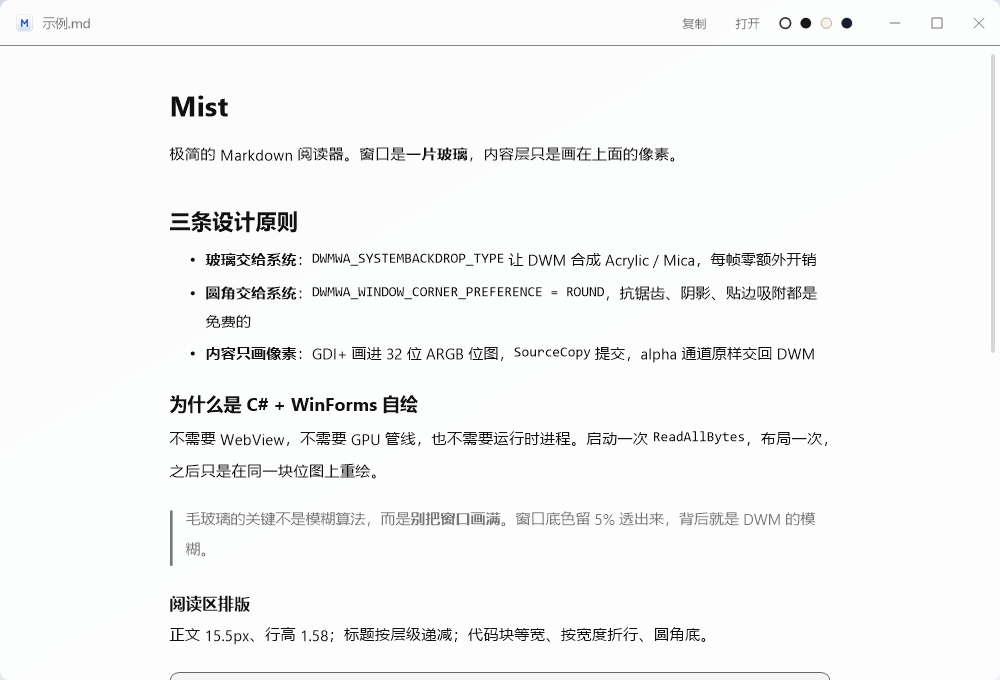
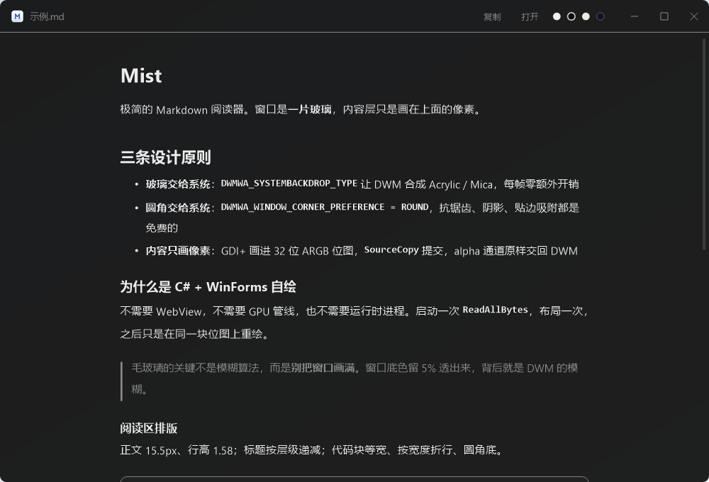

# Mist

**A 200 KB native Windows Markdown reader.** No Electron, no WebView, no background process — the window is a sheet of glass, the document is just pixels painted on it.

> 极简 Markdown 阅读器：本机 Windows 10/11，单进程、自带排版引擎、四套主题。

### [下载 Mist 1.0.0](https://github.com/cairosolan/Mist/releases/latest)

推荐 `Mist-1.0.0-win-x64-self-contained.zip`（47 MB）：解压双击即用，机器上不需要 .NET 运行时。已经装了 .NET 10 Desktop Runtime 的话，用 190 KB 的 `-framework-dependent` 版，启动更快。




## 为什么是它

- **启动快**：热启动 270–310 ms 出窗口，冷启动约 1.3 s
- **占用小**：常驻约 71 MB Working Set（私有内存 24 MB），27 线程，单进程
- **不发胖**：框架依赖版约 200 KB（`Mist.exe` + `Mist.dll`），零 NuGet 依赖
- **不将就**：真表格、CJK 逐字断行、行首行尾禁则、代码块按像素宽度折行、正文可划选复制、`Ctrl` + 滚轮无级缩放

对照一下同类的代价：Electron 类阅读器起步 100 MB 内存 + 200 MB 安装包 + 3 个后台进程。Mist 把渲染、排版、窗口装饰全部收到一个进程里，玻璃和圆角借系统现成的。

## 运行

需要 [.NET 10 Desktop Runtime](https://dotnet.microsoft.com/download/dotnet/10.0)（开发机装了 SDK 就直接能跑）。

```powershell
# 克隆后编译
dotnet build src\Mist -c Release
.\src\Mist\bin\Release\net10.0-windows\Mist.exe

# 或者直接用发布的 exe（仓库里 release 页下载）
Mist.exe                 # 空窗口，拖入 .md 文件
Mist.exe "samples\示例.md"
```

想要一份不依赖运行时的绿色版：

```powershell
dotnet publish src\Mist -c Release -r win-x64 --self-contained true -p:PublishSingleFile=true -o dist-portable
```

体积会涨到约 100 MB（WinForms 不支持 trimming / NativeAOT，这是硬约束），换来的是拷走即用。

## 操作

| 操作 | 键 |
| --- | --- |
| 打开文件 | `Ctrl+O`，或把 `.md` 拖进窗口 |
| 划选文字 | 在正文上按住左键拖动；拖到行外自动吸附到行首/行尾 |
| 复制选区 | `Ctrl+C` 或 `Ctrl+Insert`；没有选区时退化为复制全文 |
| 复制全文 | 标题栏「复制」按钮，或 `Ctrl+Shift+C`（复制的是 Markdown 源码） |
| 全选 / 取消选区 | `Ctrl+A` / `Esc` |
| 滚动 | 滚轮；空白处按住左键拖动 |
| 缩放 | `Ctrl` + 滚轮（以光标所在行为锚点，缩放后不跳位），或 `Ctrl` + `+` / `-`，`Ctrl+0` 复位 |
| 全屏阅读 | 双击标题栏最大化；最大化时版心自动从 660 放宽到 1060 |
| 切换主题 | `Ctrl+1` ~ `Ctrl+4`，或点标题栏右侧色点 |

## 四套主题

| # | 名称 | 玻璃底色 | 不透明度 |
| --- | --- | --- | --- |
| 1 | 纯白 | `#FFFFFF` | 95% |
| 2 | 纯黑 | `#090909` | 90% |
| 3 | 米白 | `#F6F1E7` | 94% |
| 4 | 墨蓝 | `#0E1626` | 91% |

全部带系统级圆角与 DWM 玻璃。深浅判断由底色亮度自动决定，深浅两套配色在代码块、行内代码、强调色上分别调过。



加新主题只需在 `Theme.cs` 的 `Theme.All` 里加一条 token 表：底色、透明度、正文色、次要文字色、代码块底色、代码文字色、强调色。

## 技术路线

C# .NET 10 + WinForms 自绘画布 + DWM 原生合成。

1. **玻璃交给系统**：`DWMWA_SYSTEMBACKDROP_TYPE` 让 DWM 合成 Acrylic / Mica，模糊和每帧开销都是零成本。程序只画内容，从不铺满窗口。
2. **圆角交给系统**：`DWMWA_WINDOW_CORNER_PREFERENCE = ROUND`，抗锯齿、投影、贴边吸附全部免费。
3. **内容只画像素**：GDI+ 画进 32 位 ARGB 位图，`CompositingMode.SourceCopy` 一次性提交，alpha 通道原样交回 DWM 合成。
4. **排版自己做**：`Markdown.cs` 把 md 拆成块，`Layout.cs` 把块排成绝对定位的绘制列表；窗口尺寸变化时重排一次，滚动只改偏移量。

关键取舍：窗口 chrome 用 `WS_THICKFRAME`（保留拉伸和贴边吸附）但去掉 `WS_CAPTION` / `WS_SYSMENU` / `WS_MIN|MAXBOX`，否则 Windows 会自己塞回一条原生标题栏；`WM_NCPAINT` 直接返回 0，边框全部自绘。

```
src/Mist/
  Program.cs      入口与命令行参数
  MainForm.cs     无边框窗口、自绘 chrome、文档视图、滚动/缩放/主题/拖放/划选
  Layout.cs       排版引擎（block → DrawOp），含表格布局与像素级折行
  Markdown.cs     md 解析（自写，不依赖任何包）
  Theme.cs        主题 token
  IconDesign.cs   图标几何绘制（9 个尺寸的 .ico）
  Association.cs  .md 文件关联注册/注销（只写 HKCU）
  Win32.cs        DWM / User32 / GDI interop
```

## 图标

两套标，同一套几何语言，都是**代码画的**而不是位图缩放：

- **程序标** `assets/Mist.ico`：圆角磨砂玻璃方块 + 深蓝 `M`。编进 exe，任务栏和 Alt-Tab 都取它，同时画在标题栏最左侧。
- **文档标** `assets/MistDoc.ico`：纸页 + 折角 + 深色 `M↓` + 两行正文提示线。`--register` 时释放到 `%LOCALAPPDATA%\Mist\icons`，资源管理器里的 `.md` 文件就显示它。

```powershell
Mist.exe --makeicons assets    # 重新生成全部 .ico 与预览图（16/20/24/32/40/48/64/128/256）
```

小尺寸单独调过：16px 自动加粗笔画，文档标在 24px 以下省掉箭头，避免糊成一团。

## 设为 .md 的默认打开程序

```powershell
Mist.exe --register      # 写入关联，弹窗确认
Mist.exe --unregister    # 撤销
```

只写 `HKCU`，不需要管理员权限：

- `HKCU\Software\Classes\Mist.Markdown`：类型名、图标、`open` 命令
- `HKCU\Software\Classes\.md`：默认 ProgId 指向 `Mist.Markdown`
- `HKCU\Software\Classes\Applications\Mist.exe`：进入「打开方式」列表
- `HKCU\Software\Mist\Capabilities` + `RegisteredApplications`：进入「设置 → 默认应用」
- 清掉旧的 `...\FileExts\.md\UserChoice(Latest)`，那是 Windows 记「上次选的程序」的地方，不清掉注册不生效

如果之后被别的程序抢回去，重跑 `--register`，或到「设置 → 应用 → 默认应用」里手动选 Mist。

## 离线自检

不用开窗口也能出图核对排版：

```powershell
Mist.exe --dump out.png "samples\示例.md" --theme 1
```

参数：`--theme 0..3`、`--zoom <v>`（0.7–1.8）、`--opaque`（关玻璃）、`--nodwm`（关 DWM 合成）、`--lowglass <alpha>`（临时压低玻璃不透明度，用于验证 alpha 链路）。

## 已知限制

- **真实模糊依赖环境**：DWM 的 Acrylic / Mica 需要「设置 → 个性化 → 颜色 → 透明效果」开启且桌面有壁纸。远程桌面、纯色背景或透明效果关闭时，DWM 会把模糊降级成纯灰底 —— 这时窗口只是半透明，不是模糊。这是系统行为，不是程序缺陷。
- **表格**：支持表头底色、行间细线、`:---` / `:---:` / `---:` 三种对齐、单元格内行内代码与粗体、超宽折行；不支持单元格内多行硬换行与 `rowspan`。
- **只是阅读器**：能划选正文，但没有搜索、没有编辑、不做多标签，一个窗口一个文件。
- **表格选区复制**用制表符分隔列，粘进表格软件能自动分列，粘进纯文本编辑器就是个近似。

## License

暂无 License 文件。默认保留所有权利；如需开源许可请自行添加 `LICENSE`。
